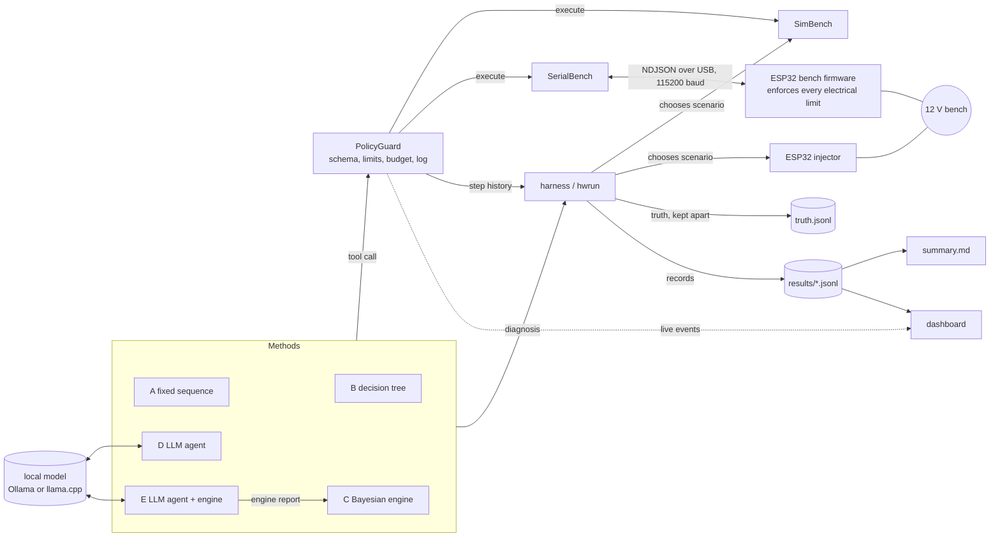

# Architecture

How the pieces fit: where a measurement comes from, what checks it on the way, who decides the next one, and where the result ends up.

## Components

| Component | Files | Job |
|---|---|---|
| Bench model | `faultdiag/circuit.py`, `measure.py` | Nodal analysis of the 12 V bench (battery polarisation, motor back-EMF and stall) and what each instrument would report |
| Fault models | `faults.py` (F1 to F5), `heldout.py` (H1 to H4) | In-model faults the engine knows; held-out faults only the harness may inject |
| Simulated bench | `simbench.py` | Implements the tools with noise, intermittent faults and injected tool failures |
| Real bench | `serialbench.py` + `firmware/bench/` | The same `execute(tool, args)` interface over USB serial to the ESP32 |
| Fault injection | `injector.py` + `firmware/injector/` | Second ESP32 switching fault relays for hardware scenarios |
| Tool contract | `tools.py`, `config/policy.json` | Tool schemas (shared with the LLM), costs, per-session limits, pulse bounds |
| Guard | `guard.py` | Every call from every method passes here: schema check, limits, budget, history, logging |
| Methods | `baselines.py` (A, B), `engine.py` (C), `agent.py` (D, E), `methods.py` | Choose measurements and submit a diagnosis |
| Cloud planners (optional) | `jev.py`, `openrouter.py`, `gemini.py` | Put TypeSafe's Jev decision model, a cloud chat model through OpenRouter (Claude, GPT, Gemini), or Gemini on Google's free tier, behind the agent's model interface, for comparison only |
| Harness | `harness.py`, `hwrun.py` | Scenarios, seeds, blind ground truth, grading, summary tables |
| Calibration | `calib.py`, `scripts/calibrate.py`, `scripts/refit_noise.py` | Gain and offset per channel, dated records, freshness check |
| Dashboard | `gui/` | Live sessions, experiment results, models, calibration, project tracker |

## Data flow

A session: the harness builds a bench for one scenario and seed (the simulator, or the injector sets the relays on hardware). The method calls tools through the guard; each call is validated, charged against the budget (40 units) and logged with its reading. The method submits a diagnosis (a status and a set of circuit elements). The harness grades it against the truth by element and appends one record to `sessions.jsonl`. On hardware the truth is written to a separate `truth.jsonl` and joined only after the run (`grade_dir`), so nothing that runs during a session can see it.

Methods D and E talk to a local OpenAI-compatible server. E receives the engine's ranked hypotheses, its proposed next measurement and its misfit flag after every reading, and decides what to do. If a reply is invalid or times out, E falls back to the engine's choice. All five methods see the same tools through the same guard.

## Tool contract

| Tool | Arguments | Returns | Cost |
|---|---|---|---|
| `read_voltage` | `point`: src, bus, motor, lamp, load | `volts` | 1 |
| `read_current` | `channel`: src, motor | `amps` | 1 |
| `load_test` | `mode`: pulse or steady; `width_ms` 10 to 500 (pulse) | source voltage and current before and during the test load | 3 (pulse), 5 (steady) |
| `human_probe` | `point_a`, `point_b`: any tap, `ret` (shared return) or `neg` (battery negative) | `volts`, typed by a technician | 10 |
| `get_history` | none | every call so far | 0 |

At most 3 load tests and 2 human probes per session (`config/policy.json`). A diagnosis names elements from one shared vocabulary (`battery`, `motor_connection`, `ground_return`, `sensor_motor`, ...), so in-model and held-out faults are graded the same way.

On the wire to the ESP32, each call is one JSON line: request `{"id": n, "tool": "...", "args": {...}}`, response `{"id": n, "status": "ok|error|timeout|safety_abort", "data": {...}, "error": "..."}`. On boot the firmware sends `{"event": "hello", "fw": ..., "calibration": ...}`; other events are `heartbeat_lost`, `overcurrent` and `test_load_forced_off`. A `hello` in the middle of a session means the board reset: the session is marked interrupted and never continued.

## Safety layers

From the bottom up. Each layer works if every layer above it is missing.

1. **Fuses** on the battery post, the main feed and every branch (ratings in `docs/HARDWARE.md`).
2. **Bench firmware**, independently of any host: safe state on boot and reset (all switched loads off); hardware watchdog; test-load pulse capped at 500 ms; a cool-down between load tests (duty cycle at most 10 %, at least 2 s); load tests refused below 11.5 V; source current above 8 A switches everything off and latches the safe state; no host heartbeat for 3 s switches everything off; load tests refused until the firmware self-test has passed.
3. **Host transport** (`serialbench.py`): refuses a board whose limits are looser than the policy; runs the firmware self-test before a session; detects resets; refuses a stale calibration.
4. **Guard** (`guard.py`): schema validation, per-session limits and the budget, for every method including the LLM.
5. **Dashboard**: a safe-state button on every page sends the firmware's `safe_state`; the latch is cleared only by a person. Closing the dashboard stops the heartbeat, and the firmware then switches the loads off by itself.

No test is ever run on 230 V AC.

## Results and provenance

`results/` holds raw JSONL, append-only. Every record carries `source` (`sim` or `hardware`), the git commit, the policy file hash, the model name and version (if any), the seed, the firmware version and calibration id (hardware), and an ISO timestamp in Africa/Lagos time. Summary tables refuse to mix sources. The dashboard reads the same files with the same summary functions, so its numbers are the command line's.
